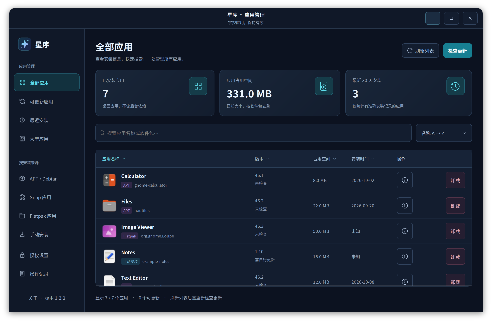
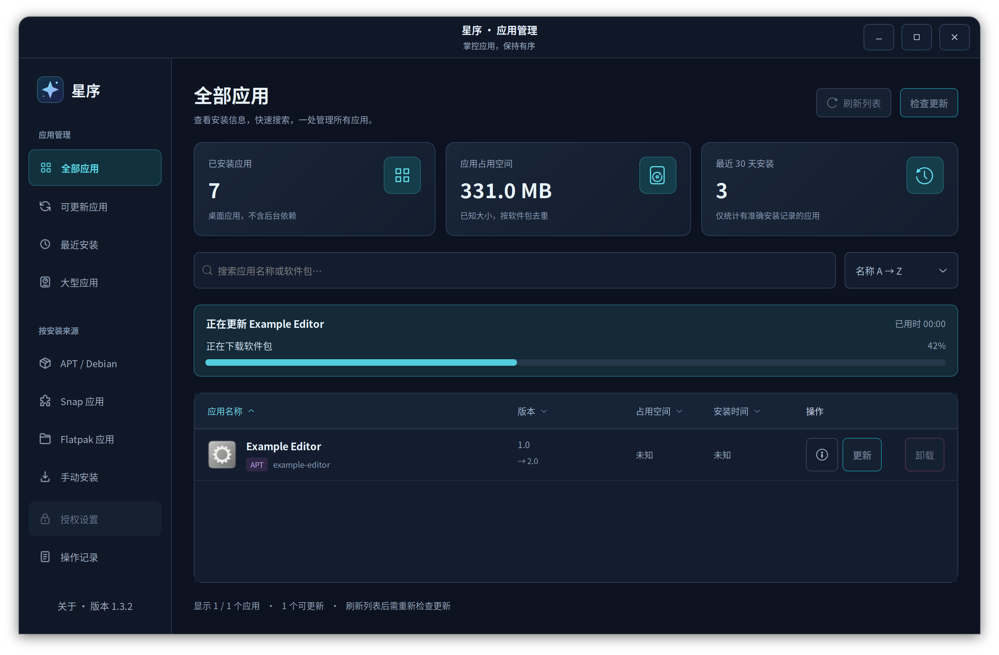

# 星序应用管理 · Xingxu

Ubuntu 原生桌面应用管理工具。查看应用图标、名称、版本、占用空间和安装日期，快速搜索、筛选，检查更新，并查看和执行更新、卸载计划。

Native Ubuntu application manager built with Python and GTK 3.



截图使用示例应用数据，不代表当前电脑的安装记录。

## 功能

- 显示桌面应用，不混入后台依赖库；空间汇总按软件包去重。
- 支持 APT / Debian、Snap、Flatpak 和可确认归属的用户目录独立安装应用。
- APT、Snap、Flatpak 支持检查更新与单个应用更新；只有发现可用更新时才显示该行的「更新」按钮。
- 可更新应用筛选、候选版本与检查失败提示；尊重 APT hold、Snap 暂停和 Flatpak mask。
- 即时搜索应用名或软件包，按来源、最近安装和大型应用筛选。
- 点击名称、版本、占用空间、安装时间旁的小箭头切换升序／降序；与下拉排序同步。未知值始终置后。
- 更新及卸载前展示影响说明；APT 展示完整模拟包变更、卸载展示包或文件清单。执行前重新核对，结束后验证状态，并保留操作记录。
- 更新时实时显示当前阶段、阶段百分比和用时；没有可靠百分比时显示活动进度条。
- 当前账号一次授权后，在星序中管理应用无需重复输入系统密码；重开软件仍有效，可在授权设置中撤销。
- 深色界面、高对比排序菜单；Ctrl+F 搜索，Ctrl+R 刷新。

## 下载与安装

**当前源码版为 1.3.2，尚未发布对应的 GitHub Release 安装包。** 可运行源码，或用 `scripts/build-deb.py` 构建 `deliverables/miemie-app-manager_1.3.2_all.deb` 后安装。

已有公开版本从 [GitHub Releases](https://github.com/wanghao9103/xingxu-app-manager/releases/latest) 下载 `miemie-app-manager_1.1.4_all.deb` 和 `SHA256SUMS`，在下载目录执行（1.1.4 不含应用更新功能）：

```bash
sha256sum -c SHA256SUMS
sudo apt install ./miemie-app-manager_1.1.4_all.deb
```

在应用菜单搜索「星序应用管理」，或运行 `miemie-app-manager`。

支持 **Ubuntu 24.04 / 26.04 的 AMD64 和 ARM64（aarch64）** 桌面环境。两种架构都下载同一个 `all.deb`：程序不捆绑 x86 二进制，APT 自动安装对应架构的 Python、GTK 和 PyGObject 依赖。

可用以下命令确认系统架构；ARM64 分别显示 `arm64` 和 `aarch64`：

```bash
dpkg --print-architecture
uname -m
```

每次 CI 在四个平台测试同一份安装包，核验真实 CPU/Ubuntu 版本、Python/PyGObject 的 ELF 架构、界面、实际安装和卸载。对应版本结果见 [GitHub Actions](https://github.com/wanghao9103/xingxu-app-manager/actions/workflows/checks.yml)。物理桌面实测为 Ubuntu 26.04.1 AMD64；ARM64 的界面验证使用原生 ARM 运行器上的 Xvfb，尚未覆盖 ARM 物理桌面、Wayland 和管理员认证交互。32 位 ARM（armhf）不在本版验证范围。

依赖包含 Python 3.10+、python3-apt、PyGObject、GTK 3、APT/dpkg 和 pkexec；Snap、Flatpak 仅在已安装对应管理器时使用。

## 从源码运行

```bash
git clone https://github.com/wanghao9103/xingxu-app-manager.git
cd xingxu-app-manager
sudo apt install python3-apt python3-gi gir1.2-gtk-3.0 librsvg2-common pkexec
./scripts/start.sh
```

也可以安装到当前用户的应用菜单，无需管理员权限：

```bash
/usr/bin/python3 scripts/install-user.py
```

用户版存放在 `~/.local/share/miemie-app-manager`。从用户版切换到系统安装包时，移除旧的 `~/.local/share/applications/io.miemie.AppManager.desktop` 用户入口，避免覆盖系统入口。

## 数据来源与卸载边界

- 应用入口来自 Gio。APT 使用 `.desktop` 文件或实际程序的 dpkg 归属，只接收已安装状态的软件包。版本和安装大小来自 dpkg。
- APT 安装日期来自留存的 dpkg 日志，兼容 gzip 轮转记录；升级不覆盖最初安装日期。记录不足时显示「未知」，不会用文件修改日期代替。
- Snap 大小为当前 `.snap` 镜像大小。Flatpak 区分用户级和系统级；未可靠取得的大小与日期显示未知。
- 独立安装支持用户自有的 `.local/bin`、`.local/opt`、XDG 数据目录和 `~/Applications`。先解析程序和简单包装脚本，再列出专用目录、桌面入口、独占图标、自启动和匹配的用户服务；确认后关闭目标程序并删除清单内文件。保留外部配置和共享图标。无法确认归属的系统目录、跨用户路径和目录符号链接不递归删除。
- APT 会展示删除及替代安装计划，执行前再次核对。核心包管理、权限和运行依赖受到保护；涉及桌面、登录或网络组件时，需输入应用名称确认。系统安装的星序自身也支持卸载，完成后自动退出。
- APT 不使用 purge/autoremove，Snap 不使用 `--purge`，Flatpak 不使用 `--delete-data`。应用维护脚本仍可能改变数据；专用安装目录内的个人文件应提前备份。
- 操作锁冲突、授权取消或命令超时会报告失败。其他包管理进程可能改变系统状态；重试前应先确认软件管理状态。
- 卸载记录保存在 `$XDG_STATE_HOME/miemie-app-manager/history.json`，默认 `~/.local/state/miemie-app-manager/history.json`，最多保留 200 条。

## 一次授权（1.3.1）

系统安装版左侧有「授权设置」。选择「授权一次，以后免密」，完成一次管理员认证后，当前电脑、当前账号通过星序检查更新、更新和卸载应用无需重复输入系统密码；关闭重开软件仍然生效。软件内的更新/卸载确认窗口保留。在同一入口可以撤销授权，卸载星序时也会清理。

授权仅适用于活动的本地会话、当前账号、星序专用的管理动作和固定助手 `/usr/libexec/miemie-app-manager-helper`。助手只接受指定应用的固定刷新/更新/移除请求，校验标识、参数和 APT 系统保护边界，忽略调用者 APT/Python 配置，不接受任意命令、参数选项或本地 deb 路径。

启用与撤销授权通过另一个始终需要身份认证的专用助手执行，不能使用免密的管理动作扩大授权。策略和状态文件归 root 所有，不存储密码；其他账号与其他程序不因此获得授权。未经一次授权时，保留 1.3.0 的系统短时授权行为。源码/用户版需先安装新版系统包才可设置一次授权。

更新进度来自实时输出：APT 使用 Status-Fd，Snap/Flatpak 尽可能读取终端百分比；没有可靠百分比时显示活动条、阶段和用时，不按时间伪造进度。只有目标版本核验成功才显示完成，错误详情仍按需查看。



示例进度来自模拟流程，展示当前阶段、阶段百分比与用时。

## 检查与执行更新

1. 点击顶部「检查更新」。APT 刷新索引，只下载软件源元数据，不升级应用；未启用长期授权时，系统可能要求身份验证；Snap、Flatpak 使用已配置的频道、分支和来源查询。
2. 列表显示可更新版本，可进入左侧「可更新应用」筛选。未检查、无更新、检查失败、锁定及独立安装的应用均不显示「更新」按钮；详情保留状态及原因。
3. 点击某个应用的「更新」，查看版本与影响说明，确认后执行，界面实时显示下载、安装配置、最终核验等阶段和已用时间；百分比对应当前阶段，不代表全流程预计耗时。取消不会执行更新。结束后核对实际版本、修订号或构建提交，并刷新列表。操作记录同时兼容已有卸载记录。

- APT 使用 Debian 版本比较规则，单独升级选中的包及必要依赖，不执行全系统升级。模拟中出现删除包则阻止；实际命令也使用 `--no-remove`。执行前重新核对候选版本、当前安装版本与完整包变更；软件源刷新部分失败也记失败。
- Snap 以修订号判断更新，不以展示版本的大小或相等判断。确认后固定目标修订，不切换当前跟踪频道；snapd 可能处理所需基础环境。
- Flatpak 区分 user / system，匹配唯一已安装的架构、分支和原来源，固定目标应用提交。所需运行库和语言扩展由 Flatpak 执行时解析，界面不把这些依赖的完整变更宣称为已经模拟；同一范围有多个应用分支时提示使用原生工具处理。未提供版本号时显示构建标识。
- 「暂无更新」只表示当前已配置来源没有提供新版本。下载的本地 deb（包括未配置更新仓库的星序）、AppImage、解压和源码安装不能据此判断官网是否发布新版本；独立应用需使用自身更新器或官方下载渠道。
- 检查失败不会显示为已是最新，也不会保留该来源旧的更新按钮。刷新列表及更新完成后清除旧检查结果，需要重新检查。星序自身通过 APT 更新成功后会退出，以便重新打开加载新版本。
- 软件源连接失败先进行受限重试；仍失败时主界面只显示简短中文说明，原始诊断通过「查看详情」打开，不展示在应用列表中。授权取消不自动重试。

命令依据：[APT 手册](https://manpages.ubuntu.com/manpages/jammy/man8/apt-get.8.html)、[Snap 更新](https://snapcraft.io/docs/how-to-guides/manage-snaps/manage-updates/)、[Snap 修订号](https://snapcraft.io/docs/revisions/)、[Flatpak 命令参考](https://docs.flatpak.org/en/latest/flatpak-command-reference.html)。

## 开发与验证

```bash
/usr/bin/python3 -m unittest discover -s tests -v
GDK_BACKEND=x11 /usr/bin/python3 scripts/preview.py .local/preview
/usr/bin/python3 scripts/build-deb.py
```

`preview.py` 仅使用示例数据生成原生界面截图并验证排序，不扫描或卸载实际应用。`smoke.py` 读取实际安装应用，验证搜索、筛选、卸载计划与确认取消；不实际卸载。完整说明见 [验证记录](docs/VERIFICATION.md) 和 [更新记录](CHANGELOG.md)。

系统操作语义参考 [Ubuntu APT 手册](https://manpages.ubuntu.com/manpages/resolute/man8/apt-get.8.html) 和 [Ubuntu 软件管理说明](https://wiki.ubuntu.com/Managing_software_on_Ubuntu)。

## 许可证

[MIT](LICENSE)。
